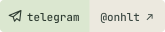
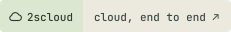

<picture>
  <source media="(prefers-color-scheme: dark)" srcset="assets/header-dark.svg">
  
</picture>

  <a href="https://bsky.app/profile/onhlt.bsky.social"><picture>
    <source media="(prefers-color-scheme: dark)" srcset="assets/badge-bluesky-dark.svg">
    
  </picture></a>&nbsp;
  <a href="https://t.me/onhlt"><picture>
    <source media="(prefers-color-scheme: dark)" srcset="assets/badge-telegram-dark.svg">
    
  </picture></a>&nbsp;
  <a href="https://github.com/2SCloud"><picture>
    <source media="(prefers-color-scheme: dark)" srcset="assets/badge-2scloud-dark.svg">
    
  </picture></a>

Backend &amp; infra gremlin. Cloud, but with opinions. <strong>Shipping over talking.</strong>

Building <a href="https://github.com/2SCloud"><strong>2SCloud</strong></a>: DNS, edge gateway and WAF modules in Rust. A cloud you can truly understand, end to end.

<picture>
  <source media="(prefers-color-scheme: dark)" srcset="assets/workspace-dark.svg">
  
</picture>

<picture>
  <source media="(prefers-color-scheme: dark)" srcset="assets/github-dark.svg">
  
</picture>

<a href="https://github.com/sponsors/onihilist"><picture>
  <source media="(prefers-color-scheme: dark)" srcset="assets/sponsors-dark.svg">
  
</picture></a>

<!--
EASTER EGG:
If you're reading this, you probably care about details.
We'd get along.
-->
